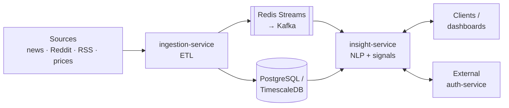
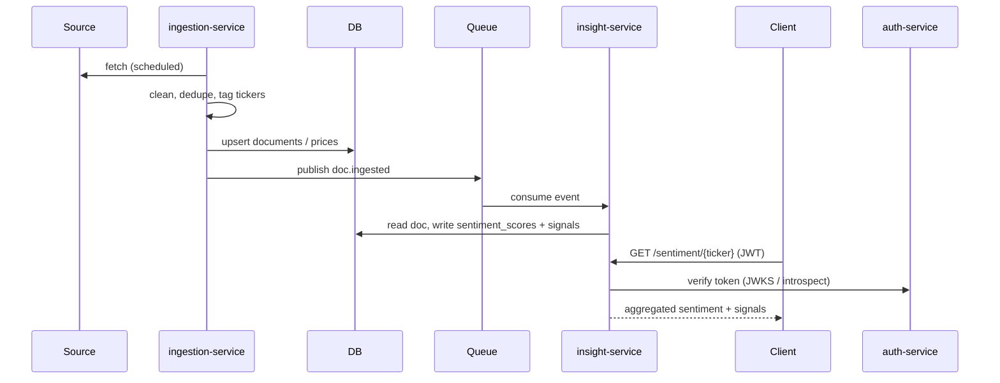

<div align="center">

# SentAnalysis

**A market sentiment engine: it ingests financial text and price data, then turns it into per-ticker sentiment and trading signals.**


</div>

> **Status: planning.** No code yet. This document is the architecture plan and its research.

## Planned features

- **Multi-source ingestion**: news (RSS, NewsAPI, GDELT), Reddit, and market prices
- **Clean ETL**: cleaning, language detection, dedupe, and ticker/entity tagging
- **Sentiment scoring**: a lexicon baseline (VADER, Loughran-McDonald) plus FinBERT as the main model
- **Aggregation**: rolling sentiment per ticker over 1h, 1d and 7d windows, weighted by source and engagement
- **Market signals**: sentiment vs. return correlation, Granger causality, z-score spike alerts
- **External auth**: every service checks JWTs issued by a separate auth service

## How it works



<details>
<summary>Main flow</summary>



</details>

| Service | Responsibility | Output |
|---|---|---|
| **ingestion-service** | Extract, transform and load text and market data on a schedule | `documents` and `prices` tables, `doc.ingested` events |
| **insight-service** | Score sentiment, aggregate it, correlate it with price, detect anomalies, serve results | `sentiment_scores` and `signals` tables, REST API |

The services talk only through the queue and a shared read-only DB schema. They never call each other directly, so each one deploys and scales on its own.

## Project structure

Every Python service uses the same layout:

```
<service>/
├── app/
│   ├── api/        # FastAPI routers: request/response wiring only
│   ├── auth/       # client for the external auth service (JWT verify, get_current_user dep)
│   ├── core/       # business logic (ETL steps / NLP pipelines)
│   ├── db/         # engine, session, repositories, Alembic migrations
│   ├── helper/     # small pure utils (dates, text cleaning, retry)
│   ├── models/     # SQLAlchemy ORM + Pydantic schemas
│   ├── config.py   # pydantic-settings, env vars
│   └── main.py     # app factory
├── tests/
├── Dockerfile
└── pyproject.toml
```

`auth/` doesn't issue tokens. It only validates tokens from the external auth service.

### `core/` per service

| Service | Module | Role |
|---|---|---|
| ingestion | `extractors/news.py` | NewsAPI, GDELT, RSS |
| ingestion | `extractors/reddit.py` | Reddit via PRAW |
| ingestion | `extractors/market.py` | Prices via yfinance / Alpha Vantage |
| ingestion | `transform.py` | Cleaning, language detection, dedupe (hash / MinHash), ticker extraction (`$AAPL` regex + NER) |
| ingestion | `load.py` | DB upsert + event publish |
| ingestion | `scheduler.py` | APScheduler first, Airflow / Prefect if pipelines grow |
| insight | `sentiment/lexicon.py` | VADER, Loughran-McDonald baseline |
| insight | `sentiment/finbert.py` | Transformer scorer |
| insight | `aggregate.py` | Rolling per-ticker windows, source/engagement weighting |
| insight | `signals.py` | Correlation, Granger causality, z-score spikes |
| insight | `topics.py` | Optional BERTopic theme detection |

## Stack

| Layer | Choice |
|---|---|
| API | FastAPI |
| ORM / migrations | SQLAlchemy 2 + Alembic |
| Storage | PostgreSQL / TimescaleDB |
| Messaging | Redis Streams first, then Kafka |
| NLP | HuggingFace Transformers, vaderSentiment |
| Data / stats | pandas / polars, statsmodels |
| Runtime | Docker Compose |

## Roadmap

| Phase | Scope |
|---|---|
| 1. MVP | RSS + Reddit ingestion → VADER scoring → `GET /sentiment/{ticker}` |
| 2. Model | FinBERT, price ingestion, aggregation windows |
| 3. Signals | Correlation, spike alerts, backtesting against price moves |
| 4. Scale | Kafka, GPU inference workers, monitoring |

## References

**Structure**
- FastAPI best practices: https://github.com/zhanymkanov/fastapi-best-practices
- Official full-stack FastAPI template: https://github.com/fastapi/full-stack-fastapi-template
- FastAPI "Bigger Applications": https://fastapi.tiangolo.com/tutorial/bigger-applications/

**Auth**
- FastAPI OAuth2 / JWT: https://fastapi.tiangolo.com/tutorial/security/oauth2-jwt/
- PyJWT with a JWKS client: https://pyjwt.readthedocs.io/en/stable/usage.html#retrieve-rsa-signing-keys-from-a-jwks-endpoint

**ETL / ingestion**
- PRAW: https://praw.readthedocs.io
- GDELT: https://www.gdeltproject.org
- yfinance: https://github.com/ranaroussi/yfinance
- Prefect: https://docs.prefect.io
- Airflow: https://airflow.apache.org

**Sentiment models**
- FinBERT paper: https://arxiv.org/abs/1908.10063
- FinBERT model: https://huggingface.co/ProsusAI/finbert
- VADER: https://github.com/cjhutto/vaderSentiment
- Loughran-McDonald dictionary: https://sraf.nd.edu/loughranmcdonald-master-dictionary/
- BERTopic: https://github.com/MaartenGr/BERTopic

**Datasets / papers**
- Financial PhraseBank: https://huggingface.co/datasets/takala/financial_phrasebank
- Twitter Financial News sentiment: https://huggingface.co/datasets/zeroshot/twitter-financial-news-sentiment
- Bollen et al., *Twitter mood predicts the stock market*: https://arxiv.org/abs/1010.3003
# SentAnalysis
