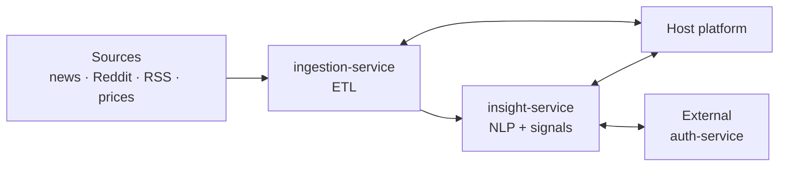
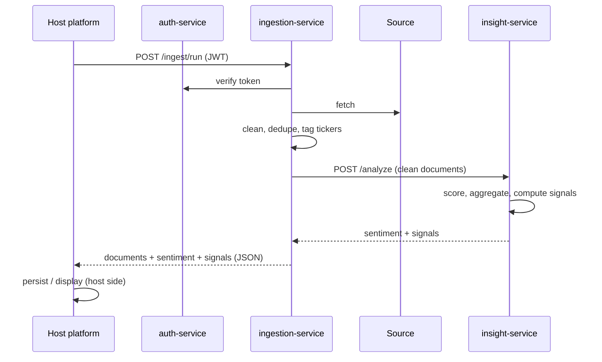

<div align="center">

# SentAnalysis

**A market sentiment engine: two backend services that collect financial text and price data and turn it into per-ticker sentiment and signals, built to plug into a larger platform.**


</div>

> **Status: planning.** No code yet. This document is the architecture plan and its research.

## Scope

| In scope | Out of scope (owned by the host platform) |
|---|---|
| Data ingestion service (ETL) | Database provisioning, schemas and storage |
| Insight service (sentiment + signals) | Frontend / dashboards |
| JSON APIs that the host platform calls | Issuing tokens (we only verify them through the external auth service) |

## Planned features

- **Multi-source ingestion**: news (RSS, NewsAPI, GDELT), Reddit, and market prices
- **Clean ETL**: cleaning, language detection, dedupe, and ticker/entity tagging
- **Sentiment scoring**: a lexicon baseline (VADER, Loughran-McDonald) plus FinBERT as the main model
- **Aggregation**: rolling sentiment per ticker over 1h, 1d and 7d windows, weighted by source and engagement
- **Market signals**: sentiment vs. return correlation, Granger causality, z-score spike alerts
- **Stateless and API-first**: no storage or UI of its own; the host platform persists and displays the results
- **External auth**: every service checks JWTs issued by the host's auth service

## How it works



<details>
<summary>Main flow</summary>



</details>

| Service | Responsibility | Input → Output |
|---|---|---|
| **ingestion-service** | Extract and transform text and market data | Source config → clean, ticker-tagged documents (JSON) |
| **insight-service** | Score sentiment, aggregate it, correlate it with price, detect anomalies | Documents + prices → sentiment scores and signals (JSON) |

The services talk over HTTP with JSON contracts defined in `models/`. Neither one stores data itself. Any persistence goes through the host's database, accessed by the `db/` connector.

## Project structure

Every Python service uses the same layout:

```
<service>/
├── app/
│   ├── api/        # FastAPI routers: request/response wiring only
│   ├── auth/       # client for the external auth service (JWT verify, get_current_user dep)
│   ├── core/       # business logic (ETL steps / NLP pipelines)
│   ├── db/         # thin connector to the host's database (no schema/migrations owned here)
│   ├── helper/     # small pure utils (dates, text cleaning, retry)
│   ├── models/     # Pydantic schemas: the API/data contracts
│   ├── config.py   # pydantic-settings, env vars
│   └── main.py     # app factory
├── tests/
├── Dockerfile
└── pyproject.toml
```

- `auth/` doesn't issue tokens. It only validates tokens from the external auth service.
- `db/` doesn't create or migrate anything. It only connects to whatever database the host provides, and stays optional while the host consumes the JSON responses directly.

### `core/` per service

| Service | Module | Role |
|---|---|---|
| ingestion | `extractors/news.py` | NewsAPI, GDELT, RSS |
| ingestion | `extractors/reddit.py` | Reddit via PRAW |
| ingestion | `extractors/market.py` | Prices via yfinance / Alpha Vantage |
| ingestion | `transform.py` | Cleaning, language detection, dedupe (hash / MinHash), ticker extraction (`$AAPL` regex + NER) |
| ingestion | `publish.py` | Send clean batches to insight-service / return them to the host |
| ingestion | `scheduler.py` | Optional APScheduler trigger; the host can call `/ingest/run` instead |
| insight | `sentiment/lexicon.py` | VADER, Loughran-McDonald baseline |
| insight | `sentiment/finbert.py` | Transformer scorer |
| insight | `aggregate.py` | Rolling per-ticker windows, source/engagement weighting |
| insight | `signals.py` | Correlation, Granger causality, z-score spikes |
| insight | `topics.py` | Optional BERTopic theme detection |

## Stack

| Layer | Choice |
|---|---|
| API | FastAPI |
| Contracts | Pydantic v2 |
| HTTP client | httpx |
| NLP | HuggingFace Transformers, vaderSentiment |
| Data / stats | pandas / polars, statsmodels |
| Runtime | One Docker image per service |

## Roadmap

| Phase | Scope |
|---|---|
| 1. MVP | RSS + Reddit ingestion → VADER scoring → `POST /analyze` returns JSON |
| 2. Model | FinBERT, price ingestion, aggregation windows |
| 3. Signals | Correlation, spike alerts, backtesting against price moves |
| 4. Integration | Host DB connector in `db/`, GPU inference worker, health/metrics endpoints |

## References

**Structure**
- FastAPI best practices: https://github.com/zhanymkanov/fastapi-best-practices
- FastAPI "Bigger Applications": https://fastapi.tiangolo.com/tutorial/bigger-applications/

**Auth**
- FastAPI OAuth2 / JWT: https://fastapi.tiangolo.com/tutorial/security/oauth2-jwt/
- PyJWT with a JWKS client: https://pyjwt.readthedocs.io/en/stable/usage.html#retrieve-rsa-signing-keys-from-a-jwks-endpoint

**ETL / ingestion**
- PRAW: https://praw.readthedocs.io
- GDELT: https://www.gdeltproject.org
- yfinance: https://github.com/ranaroussi/yfinance
- APScheduler: https://apscheduler.readthedocs.io

**Sentiment models**
- FinBERT paper: https://arxiv.org/abs/1908.10063
- FinBERT model: https://huggingface.co/ProsusAI/finbert
- VADER: https://github.com/cjhutto/vaderSentiment
- Loughran-McDonald dictionary: https://sraf.nd.edu/loughranmcdonald-master-dictionary/
- BERTopic: https://github.com/MaartenGr/BERTopic

**Datasets / papers**
- Financial PhraseBank: https://huggingface.co/datasets/takala/financial_phrasebank
- Twitter Financial News sentiment: https://huggingface.co/datasets/zeroshot/twitter-financial-news-sentiment
- Bollen et al., *Twitter mood predicts the stock market*: https://arxiv.org/abs/1010.3003
